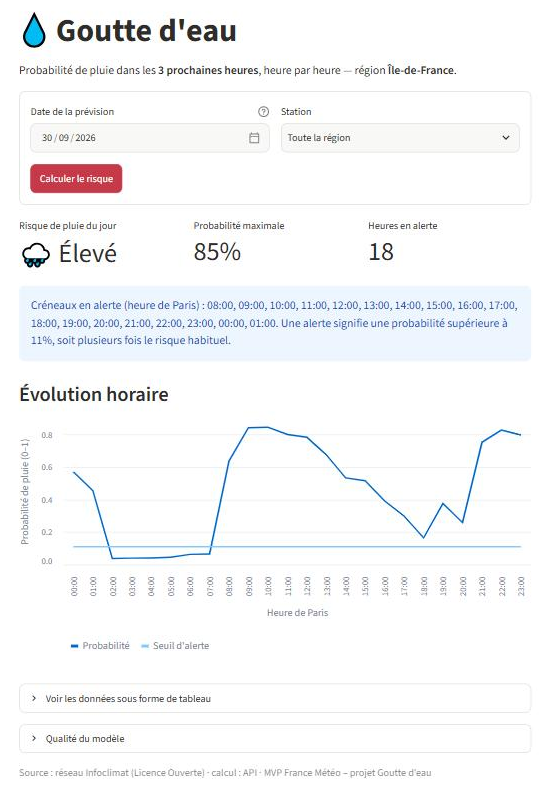

# Goutte d'eau : prévision du risque de pluie (MVP)

Première version du projet Goutte d'eau (France Météo). On donne une date, et l'outil estime pour chaque heure
la probabilité qu'il tombe au moins 0,2 mm de pluie dans les 3 heures qui suivent. L'idée est d'aider les
agriculteurs à organiser leurs travaux.

Pour ce MVP, je me suis limité à l'Île-de-France (9 stations) et au mois de septembre 2026, avec les données
du réseau Infoclimat (Licence Ouverte).

```
API Infoclimat / export CSV ─► collecte ─► nettoyage + contrôle qualité ─► SQLite ─► variables horaires ─► forêt aléatoire
                                                                                                              │
                                              Streamlit ◄── JSON ── FastAPI GET /prevision?date= ◄────────────┘
```

## Démarrage rapide

```bash
python -m venv .venv && source .venv/bin/activate      # Windows : .venv\Scripts\activate
pip install -r requirements.txt
make tout          # collecte + entraînement + graphiques + tests
make api           # http://localhost:8000/docs  (documentation OpenAPI interactive)
make ui            # http://localhost:8501       (dans un second terminal)
```

Sous Windows, pas besoin de `make` : il suffit de lancer dans l'ordre les scripts du dossier `windows/`.

| Script | Rôle |
|---|---|
| `1_installer_et_tester.bat` | crée `.venv`, installe les dépendances, collecte, entraîne, génère les graphiques, lance les tests (résultat dans `reports/resultats_tests.txt`) |
| `2_lancer_api.bat` | lance l'API et ouvre http://localhost:8000/docs |
| `3_lancer_interface.bat` | lance l'API et l'interface, ouvre http://localhost:8501 |
| `5_publier_sur_github.bat` | relie le dépôt à un dépôt GitHub vide et pousse la branche `main` |

Pour lancer les étapes une par une (Linux, macOS) :

```bash
export PYTHONPATH=src                                   # Windows PowerShell : $env:PYTHONPATH="src"
python -m goutte.collecte --csv data/export_infoclimat.csv
python -m goutte.entrainement
python -m goutte.rapport
pytest -q
uvicorn api.main:app --reload
streamlit run app/streamlit_app.py
```

On peut aussi collecter directement depuis l'API Infoclimat. Il faut un jeton (gratuit, lié à l'adresse IP), à demander sur infoclimat.fr/opendata :

```bash
export INFOCLIMAT_TOKEN=xxxxx
python -m goutte.collecte --api --debut 2026-09-01 --fin 2026-09-30
```

Il y a aussi une image Docker pour l'API seule : `docker build -t goutte . && docker run -p 8000:8000 goutte`.

## Arborescence

| Chemin | Rôle |
|---|---|
| `src/goutte/config.py` | Paramètres : stations, colonnes utiles, bornes physiques, seuils |
| `src/goutte/collecte.py` | Lecture de l'API Infoclimat ou d'un export CSV, chargement en base |
| `src/goutte/nettoyage.py` | Colonnes utiles, typage, doublons, valeurs aberrantes, point de rosée |
| `src/goutte/features.py` | Agrégation horaire, contrôle des pluviomètres, variables explicatives, cible |
| `src/goutte/db.py` | Schéma SQLite et accès aux données |
| `src/goutte/entrainement.py` | Validation croisée par jour, test temporel, choix du modèle et du seuil |
| `src/goutte/prediction.py` | Service de prévision partagé par l'API et l'interface |
| `src/goutte/rapport.py` | Graphiques d'évaluation (`reports/`) |
| `api/main.py` | API REST FastAPI |
| `app/streamlit_app.py` | Interface de démonstration |
| `tests/` | Tests unitaires et d'API (pytest) |
| `docs/` | Diagrammes (Graphviz `.dot` + PNG), planning, budget, fiche modèle |

## Données

L'export compte 29 colonnes, mais je n'en lis que 11 et j'en stocke 10. Les autres (visibilité, ensoleillement, UV,
température du sol, code temps OMM) sont vides à plus de 80 % ou n'ont pas de rapport avec ce qu'on cherche à prédire,
donc je ne les garde pas.

À chaque collecte, les données passent par ces contrôles :

* bornes physiques (température −40 à 50 °C, pression 950 à 1 060 hPa, humidité 0 à 100 %…) : valeur hors bornes → vide ;
* doublons `(station, horodatage)` supprimés ;
* point de rosée recalculé (formule de Magnus) quand il manque ;
* pluie horaire prise dans `pluie_1h` (mesure du pluviomètre) ; l'intensité instantanée, qui surestime les averses
  brèves, ne sert qu'en dernier recours ;
* contrôle des pluviomètres : une station sans aucune mesure de pluie est classée `absent`, une station qui reste
  à 0 mm alors qu'au moins 3 voisines mesurent de la pluie deux jours différents est classée `suspect`.
  Ces stations ne servent ni pour la cible ni pour le contexte régional. En septembre 2026, ça concerne Plaisir
  (000TC, `absent`) et Argenteuil (000P7, `suspect`).

### Base SQLite (`data/goutte.db`)

| Table | Contenu | Clé |
|---|---|---|
| `stations` | identifiant, nom, région, statut du pluviomètre | `station_id` |
| `observations` | mesures nettoyées au pas natif (10 à 30 min) | `(station_id, dh_utc)` |
| `mesures_horaires` | mesures agrégées à l'heure, lues par le modèle et l'API | `(station_id, heure_utc)` + index `heure_utc` |
| `entrainements` | historique des entraînements et de leurs métriques | `id` |

## Modèle

La cible est simple : est-ce qu'il tombe au moins 0,2 mm de pluie à la station dans les 3 heures suivantes ?

Le modèle s'appuie sur 15 variables : température, humidité, écart au point de rosée, pression et sa tendance
sur 3 h, vent (force, et direction en sin/cos), pluie de l'heure et des 3 dernières heures, heure du jour (sin/cos),
et trois variables de contexte régional (pluie moyenne, nombre de stations sous la pluie, tendance de pression).

J'ai comparé deux modèles : une régression logistique avec classes pondérées, et une forêt aléatoire (200 arbres,
profondeur 6). Pour la forêt, je n'ai pas pondéré les classes afin de garder des probabilités bien calibrées.
Pas de deep learning ici, ce n'était pas utile : tout l'entraînement, validation croisée comprise, tourne en
6 secondes environ sur un CPU.

Pour l'évaluation, j'ai fait une validation croisée à 5 plis groupés par jour, pour éviter qu'une même journée se
retrouve à la fois dans l'apprentissage et dans le test. J'ai ajouté un test temporel : apprentissage du 1er au
22 septembre, test du 23 au 30.

Le modèle retenu est celui qui a la meilleure PR-AUC en validation croisée. Pour le seuil d'alerte, j'ai pris celui
qui maximise le F2, qui donne deux fois plus de poids au rappel : pour un agriculteur, rater une pluie coûte plus
cher qu'une fausse alerte.

Jeu d'apprentissage : 4 340 heures-station, 7 stations, 173 positifs (4,0 %), 8 jours de pluie.

| | ROC-AUC | PR-AUC | Rappel | Précision | F2 | Brier |
|---|---|---|---|---|---|---|
| Forêt aléatoire (retenue, seuil 0,11) | 0,836 | 0,437 | 0,63 | 0,39 | 0,56 | 0,029 |
| Régression logistique (seuil 0,59) | 0,891 | 0,400 | 0,65 | 0,20 | 0,45 | 0,101 |
| Persistance (« il pleut, il pleuvra ») | 0,635 | 0,200 | 0,28 | 0,62 | 0,31 | 0,036 |
| Climatologie (fréquence moyenne) | 0,500 | 0,040 | 0 | – | 0 | 0,038 |

Sur le test temporel (23–30 septembre), la forêt aléatoire obtient ROC-AUC 0,88, PR-AUC 0,54, rappel 0,53, précision 0,66, F2 0,55,
contre 0,39 en F2 pour la persistance.

Attention quand même : avec un seul mois de données et 8 jours de pluie, ces chiffres montrent surtout que la chaîne
fonctionne de bout en bout, pas que le modèle est prêt pour un usage réel. La phase 1 du projet prévoit de travailler
sur 5 ans d'historique. Plus de détails dans `docs/fiche_modele.md`.

## API

| Méthode | Route | Description |
|---|---|---|
| GET | `/sante` | état du service et période couverte |
| GET | `/stations` | liste des stations et statut de leur pluviomètre |
| GET | `/prevision?date=AAAA-MM-JJ[&station_id=]` | risque journalier et prévisions horaires |
| GET | `/modele` | modèle retenu et indicateurs de qualité |

Exemple : `GET /prevision?date=2026-09-30`

```json
{
  "date": "2026-09-30", "region": "Île-de-France", "station_id": null, "horizon_h": 3,
  "risque_journalier": 0.846, "niveau_journalier": "élevé", "pluie_attendue": true,
  "heures_a_risque": ["08:00", "09:00", "10:00", "..."],
  "seuil_decision": 0.11, "modele": "foret_aleatoire",
  "previsions_horaires": [
    {"heure_utc": "06:00", "heure_locale": "08:00", "probabilite": 0.638,
     "probabilite_max_station": 0.711, "niveau": "élevé", "stations": 7}
  ]
}
```

Niveaux : `faible` sous le seuil d'alerte, `modéré` entre le seuil et 50 %, `élevé` au-delà de 50 %.
Codes d'erreur : 422 si la date est mal formée, 404 si la date n'est pas couverte ou la station inconnue,
401 si la clé d'API est requise et absente.

Côté sécurité : les paramètres sont validés avec Pydantic, le CORS est limité à l'interface et seule la méthode GET
est acceptée. Si la variable `GOUTTE_API_KEY` est définie, l'API demande une clé dans l'en-tête `X-API-Key`.
Le temps de traitement est renvoyé dans l'en-tête `X-Temps-Traitement-ms`.

## Interface



## Indicateurs qualité

| Domaine | Indicateur | Cible MVP | Mesuré |
|---|---|---|---|
| Données | complétude température / pression | ≥ 95 % | 100 % |
| Données | complétude humidité | ≥ 80 % | 85 % |
| Données | doublons et valeurs hors bornes après nettoyage | 0 | 0 |
| Données | pluviomètres contrôlés | 100 % | 9 / 9 (2 écartés) |
| Modèle | PR-AUC en validation croisée | ≥ 2 × persistance | 0,437 (× 2,2) |
| Modèle | rappel au seuil d'alerte | ≥ 0,60 | 0,63 |
| Modèle | F2 sur le test temporel | > persistance | 0,55 contre 0,39 |
| Modèle | score de Brier | < climatologie | 0,029 contre 0,038 |
| API | temps de traitement `/prevision` (service, à chaud) | < 300 ms | ≈ 40 ms |
| Code | tests automatisés | verts en CI | 7 tests + 6 tests d'API |

## Travail collaboratif

Le fonctionnement est décrit dans `CONTRIBUTING.md`. En résumé : on travaille sur des branches `feature/*`, on passe
par une pull request relue avant de fusionner sur `main`, la CI tourne sur GitHub Actions, et le backlog est suivi
dans GitHub Projects (modèles d'issue « user story » et « anomalie »).

## Licence et sources

Code : MIT. Données : © Infoclimat, Licence Ouverte / Open Licence.
